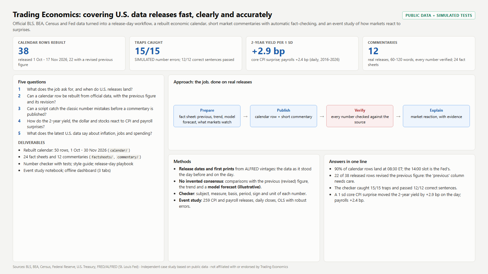

# Trading Economics: covering U.S. data releases fast, clearly and accurately

Official BLS, BEA, Census and Fed data turned into a release-day workflow, a rebuilt economic calendar, short market
commentaries with automatic fact-checking, and an event study of how markets react to surprises.

Independent case study built for the *Data Analyst - Americas* (economic news writer) role at Trading Economics.
Based on public data; not affiliated with or endorsed by Trading Economics. **Not investment advice.**

- **Report (8 pages):** [docs/TradingEconomics_US_releases_case_study.pdf](docs/TradingEconomics_US_releases_case_study.pdf)
- **Interactive dashboard (one HTML file, works offline, 3 tabs):** [dashboard/us_releases.html](https://albt-france.github.io/trading-economics-us-releases-case-study/dashboard/us_releases.html)



## Key results
1. **The calendar is mostly an 08:30 ET job, and "previous" is a moving target.** 90% of the 50 rows of the rebuilt Oct-Nov 2026 calendar land at 08:30 ET; in 22 of 38 released rows the release revised the previous figure (September payrolls: first reported at 29,000, revised to 60,000 a month later).
2. **A short script catches the classic number errors.** The checker flagged all 15 planted errors (month vs year, forgotten revision, SA vs NSA, sign, units, reference month, verb vs direction, untraceable number) and passed all 12 correct control sentences.
3. **Markets react to the surprise, most clearly in short-term rates.** Across 232 CPI and payroll releases since 2016 (Mar 2020 - Mar 2021 excluded), a 1-standard-deviation surprise moved the 2-year Treasury yield by +2.9 bp (core CPI; 95% CI +1.1 to +4.7) and +2.4 bp (payrolls; +0.8 to +4.0) on the day, and the dollar by +0.16% (CPI). Average 2-year moves are 1.6x larger on CPI days and 1.8x on payroll days than on other days.
4. **Real data has traps the format must handle.** The October 2025 CPI index was never published (2025 lapse in appropriations), so the October 2026 year-on-year CPI cannot be computed from published indexes; the calendar says so instead of estimating it. 1,840/1,840 values were identical across two official channels (BLS API vs FRED; Treasury vs FRED).

## What is in the repository
```
src/fetch_releases.py     BLS API, FRED/ALFRED vintages, Treasury, Fed and agency schedules -> data/processed
src/build_factsheets.py   rebuilt calendar + one fact sheet per release (markdown for people, JSON for the checker)
src/fact_check.py         number checker for commentaries (tests: tests/test_fact_check.py, traps: data/_traps.csv)
src/event_study.py        surprises vs market moves, volatility on release days, trends, cross-checks -> data/outputs
src/make_notebook.py      writes and runs notebooks/event_study.ipynb
src/build_dashboard.py    dashboard/us_releases.html (Calendar, Indicators, Market reactions)
src/build_pdf.py          8-page report (HTML + SVG charts printed by headless Edge) and page images in docs/img
```

## Reproduce
```bash
python -m venv .venv
.venv/Scripts/pip install -r requirements.txt        # (macOS/Linux: .venv/bin/pip)
python src/fetch_releases.py      # about 15 minutes the first time (polite pace), then cached
python src/build_factsheets.py
pytest
python src/event_study.py
python src/make_notebook.py
python src/build_dashboard.py
python src/build_pdf.py           # needs Microsoft Edge
```
No key is needed. Optional free keys (`BLS_API_KEY`, `FRED_API_KEY`) go in a local `.env` file, never committed.
Check a new commentary: `python src/fact_check.py commentary/<release>.md`.

## Methods
- **Release dates, first prints, revisions.** ALFRED keeps every past vintage of BLS, BEA, Census and Fed series. For each
  release, the data are read as they stood the day before and on the day: *actual* is the first print, *previous* is what
  readers had seen, *revised* is the new value of the previous figure. Dates were checked against the BLS, BEA and Census schedules.
- **No invented consensus.** There is no free, reliable public consensus. Comparisons use the previous (revised) figure, the
  3- and 12-period averages and a **model forecast (illustrative)**: the average of the last three changes, or the last level,
  computed only from data public the day before.
- **Checker.** Each number of a commentary must match the fact sheet at the published rounding, with the right subject,
  month-on-month or year-on-year measure, seasonal basis, reference period, sign and unit; a previous-period figure must be
  the revised one. Tested on planted errors (SIMULATED) and on correct control sentences.
- **Event study.** CPI and payroll releases since 2016. Surprise = first print minus the model, in standard deviations. Market
  move = daily close-to-close change on the release day. OLS with HC1 robust errors; reference months Mar 2020 - Mar 2021 excluded.
- **Commentaries.** 60-120 words: fact headline, number and comparison, drivers, market reaction on the day, one line of context.
- **AI-assisted workflow**: I used Claude, mainly to write scripts faster. I drove the project: I defined the questions, chose and validated the data sources, made the analytical decisions and checked every result.

## Sources
BLS Public Data API; ALFRED and FRED (Federal Reserve Bank of St. Louis), which republish BLS, BEA, Census, Labor Department,
Federal Reserve, Treasury, EIA and S&P data; U.S. Treasury daily par yield curve; Federal Reserve FOMC calendar; BEA and Census
release schedules. Trading Economics' public About, Careers and API documentation pages were read by hand for company facts
(quoted "as stated by Trading Economics") and for the field list of a calendar row; no Trading Economics data or text is used.
Details and collection date: [data/SOURCES.md](data/SOURCES.md).

## Limits
- Daily closes only: other news of the same day is in the market move; intraday data would isolate the minutes after 08:30.
- Surprises are measured against a simple model, not a market consensus, so they are noisier and the slopes understated.
- The October 2025 CPI index was never published (2025 lapse in appropriations), so October 2026 year-on-year CPI is left empty.
- Census and BEA series are read from FRED/ALFRED copies (the Census API now requires a key); October 2026 retail sales were
  published on the collection day but were not yet in the archive.
- SIMULATED parts: the planted errors used to test the checker and the release-evening timing scenario. Everything else is public data.

---
Independent case study based on public data · not affiliated with or endorsed by Trading Economics · not investment advice.
